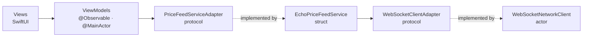
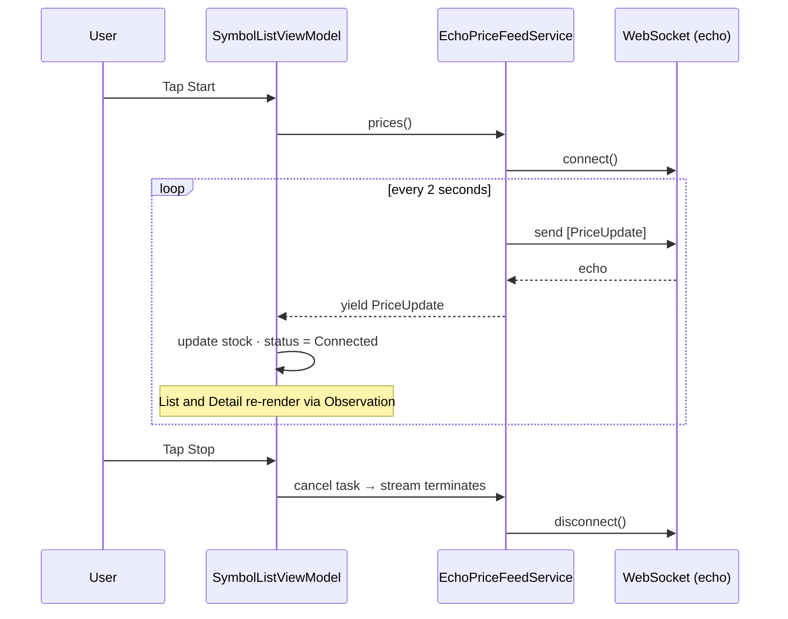

# PriceTracker

A SwiftUI app that tracks live prices for 25 stock symbols over a WebSocket. Prices are generated on the device, sent to an echo server, and every echoed message updates the list and the detail screen in real time.

<p align="center">
  
  &nbsp;&nbsp;
  
  &nbsp;&nbsp;
  
</p>
<p align="center">
  <sub>Sorted by price&nbsp;&nbsp;·&nbsp;&nbsp;Sorted by price change&nbsp;&nbsp;·&nbsp;&nbsp;Symbol detail</sub>
</p>

---

## Features

| | |
|---|---|
| **Live prices** | 25 symbols (AAPL, MSFT, NVDA, GOOG, AMZN, TSLA, …) update every 2 seconds through `wss://ws.postman-echo.com/raw`. |
| **Price change indicator** | Green ▲ / red ▼ / grey — with the percentage move since the last update, on both screens. |
| **Sorting** | Segmented control to sort by **Price** or **Price Change**. Ties fall back to the ticker so rows never jump randomly. |
| **Connection status** | Colored dot in the top-left: red when disconnected, orange while connecting, green when connected. |
| **Start / Stop** | One button controls the feed and the socket. Stop closes the connection cleanly. |
| **Symbol detail** | Ticker as the title, company name, live price with the same indicator, and a description. Updates while you're on the screen. |
| **English + Arabic** | Full String Catalog, right-to-left layout, locale-aware number and currency formatting. |

## Requirements

- Xcode 16 or later
- iOS 17.0+
- Swift 6 language mode (strict concurrency)

## Getting started

```bash
git clone <repo-url>
cd PriceTracker
open PriceTracker.xcodeproj
```

Pick a simulator and press **⌘R**, then tap **Start**.

Run the tests with **⌘U**, or from the command line:

```bash
xcodebuild test \
  -project PriceTracker.xcodeproj \
  -scheme PriceTracker \
  -destination 'platform=iOS Simulator,name=iPhone 16'
```

## Configuration

Every app-wide setting lives in one file, `PriceTracker/App/AppConstants.swift`:

```swift
enum AppConstants {
    enum PriceFeed {
        static let url = URL(string: "wss://ws.postman-echo.com/raw")!
        static let updateInterval: Duration = .seconds(2)
        static let maxPriceChange = 0.02   // ±2% per tick
    }
    enum Formatting {
        static let currencyCode = "USD"
    }
}
```

## Architecture



| Layer | Type | Responsibility |
|---|---|---|
| `SymbolListView`, `SymbolDetailView` | SwiftUI View | Render state and forward user actions. |
| `SymbolListViewModel` | `@Observable`, `@MainActor` | Owns the feed and is the **single source of truth** for prices. Sorting, connection status, Start/Stop. |
| `SymbolDetailViewModel` | `@Observable`, `@MainActor` | Reads its symbol from the shared ViewModel, so the detail screen updates live with no extra plumbing. |
| `PriceFeedServiceAdapter` → `EchoPriceFeedService` | Protocol → `Sendable` struct | Each tick: generate prices, send them, read the echo, yield each `PriceUpdate` on an `AsyncThrowingStream`. |
| `PriceGenerator` | Enum | Random move within ±2%, rounded to cents. |
| `WebSocketClientAdapter` → `WebSocketNetworkClient` | Protocol → actor | Pure transport: connect, send, receive, disconnect. Knows nothing about stocks. |
| `AppDependencies` | Struct | Composition root — the only place that creates concrete types. |

### How a price reaches the screen



### Concurrency decisions

- **Only Views and ViewModels are `@MainActor`.** The project's default actor isolation is `nonisolated`, so models, the service and the client stay off the main thread.
- **No Combine.** Data flows through `AsyncThrowingStream` and `async/await`.
- **No locks.** The feed's running prices live inside its own task; the socket lives inside the client actor.
- **Structured teardown.** Stop cancels the consuming task → the stream terminates → the feed task is cancelled → the client disconnects after the loop has actually stopped.

### Project structure

```
PriceTracker/
├── App/            PriceTrackerApp, AppDependencies, AppConstants
├── Features/
│   ├── SymbolList/     View, ViewModel, Row
│   └── SymbolDetail/   View, ViewModel
├── Models/         Stock, Stock+Catalog, PriceUpdate, ConnectionStatus
├── Networking/     WebSocketClient (protocol + URLSession actor)
├── Services/       PriceFeedServiceAdapter, EchoPriceFeedService, PriceGenerator
├── Shared/         PriceChangeView, ConnectionStatusView
└── Resources/      Localizable.xcstrings, InfoPlist.xcstrings
PriceTrackerTests/
├── Mocks/          MockWebSocketClient, MockPriceFeedService
├── Helpers/        Fixtures, waitUntil
└── *Tests.swift
```

## Localization

- English and Arabic, in `Resources/Localizable.xcstrings`. The app name is localized in `InfoPlist.xcstrings` (Price Tracker · متتبع الأسعار).
- All 25 symbol descriptions are translated. Tickers and company names stay in their original form, as on Gulf-market trading apps.
- Right-to-left layout comes from SwiftUI's `leading`/`trailing`; price arrows point up/down, so they don't need mirroring.
- Prices and percentages use `FormatStyle`, so digits and separators follow the user's locale.
- **Try it:** Edit Scheme → Run → Options → App Language → Arabic, or open the **Arabic** Xcode Preview.

## Testing

30 unit tests, all deterministic: no real network, and async tests poll with a timeout instead of fixed sleeps.

| Suite | What it proves | Technique |
|---|---|---|
| `StockTests` | Change, percentage and direction math; catalog has 25 unique symbols; wire format round-trips. | Pure unit tests |
| `PriceGeneratorTests` | Moves stay within ±2%, are rounded to cents, never go below one cent. | Property-style loops |
| `EchoPriceFeedTests` | Connects once, one update per symbol per tick, yields exactly what was echoed, surfaces receive errors, disconnects on cancel. | `MockWebSocketClient` actor that echoes like Postman |
| `SymbolListViewModelTests` | Connecting → Connected on first price, Start / Stop / toggle, stream terminates on Stop, error handling, both sort orders, unknown symbols ignored. | `MockPriceFeedService` driven by a test-owned continuation |
| `SymbolDetailViewModelTests` | Detail reflects feed updates and **notifies observers** — proof that SwiftUI re-renders the detail screen. | `withObservationTracking` |
| `LocalizationTests` | Every UI string has an Arabic translation; every symbol has an English and Arabic description. | Reads compiled `en.lproj` / `ar.lproj` |

### CI

`.github/workflows/ios-tests.yml` runs the full suite on every push to `main` and every pull request, with code coverage enabled, and uploads the `.xcresult` bundle. The shared `PriceTracker` scheme runs tests in parallel.

## Possible next steps

- Reconnect automatically with backoff after a dropped connection.
- Persist the last known prices so the list isn't stale on launch.
- A sparkline of recent prices on the detail screen.
